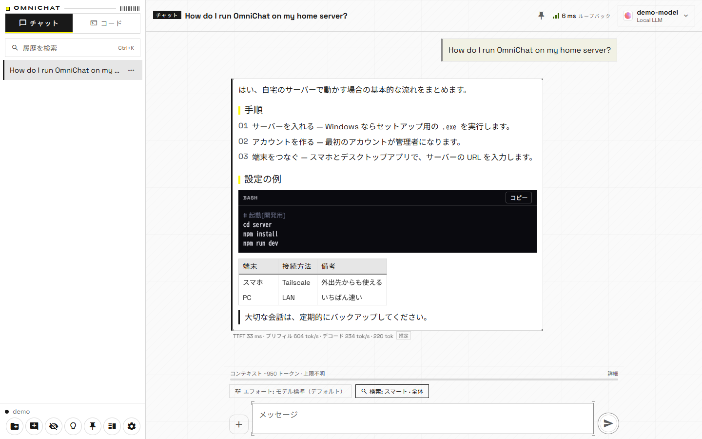
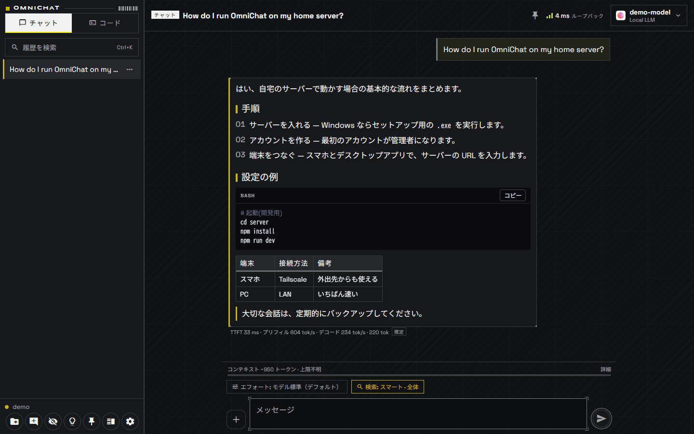
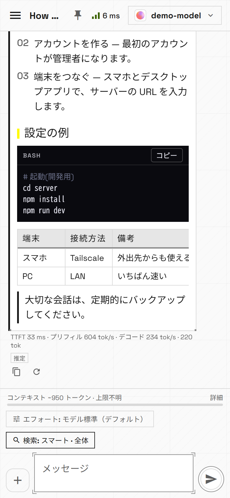
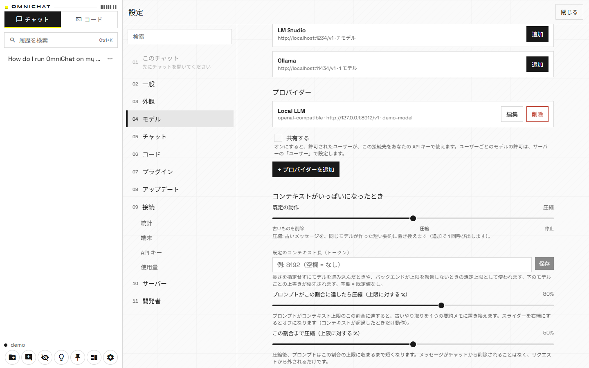
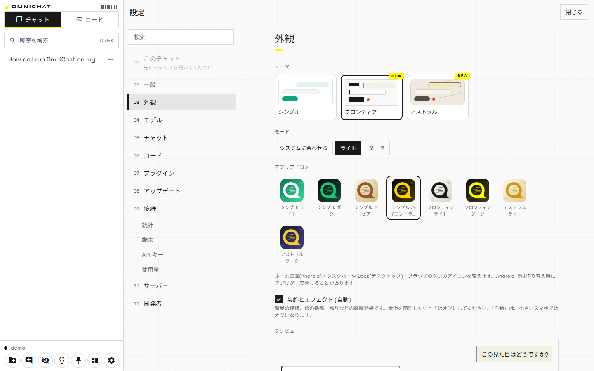

# OmniChat

**English** | [日本語](README.ja.md)

A self-hosted AI chat app that runs on your own server (for example a PC at home). Conversations, projects and settings are stored in the server's SQLite database, so you see the same content from any browser, phone or desktop and can continue a chat from another device. The backend is any OpenAI-compatible API (OpenAI / DeepSeek / Ollama / LM Studio / llama.cpp / vLLM, ...), and there is also a route to remote-control DeepSeek Harness (dsh) on your PC.

- Meant for personal use by "you and your family". Large multi-tenant operation is not a goal.
- Licensed under AGPL-3.0 (see [License](#license)).
- **Use at your own risk.** It is provided without warranty, and the author takes no responsibility for any damage or disadvantage arising from its use (see [Disclaimer](#disclaimer)).
- **Language note:** the app's UI is available in Japanese and English. Most of the documentation under `docs/` is currently written in Japanese only; this README is the English entry point, and [README.ja.md](README.ja.md) is the Japanese version.

## Download

Get the latest version from **[the latest release](https://github.com/remuno3751/omnichat/releases/latest)** ("Assets").

### OmniChat app (client)

Connects from your phone or PC to your own server.

[](https://github.com/remuno3751/omnichat/releases/latest/download/OmniChat-Desktop-Windows-x64-Setup.exe) [](https://github.com/remuno3751/omnichat/releases/latest/download/OmniChat-Desktop-macOS-universal.dmg) [](https://github.com/remuno3751/omnichat/releases/latest/download/OmniChat.apk)

On Linux, use the web client (open the server's URL in a browser) or build from source.

### OmniChat Server

The core that stores conversations and connects your devices. Run it on your own PC, NAS or VPS.

[](https://github.com/remuno3751/omnichat/releases/latest/download/OmniChat-Server-App-Windows-x64-Setup.exe) 

Docker image: coming soon. macOS / Linux: install from source (see [docs/INSTALL.md](docs/INSTALL.md), Japanese).

> **v0.5.0 is the first public version.** It is a 0.x release, so behavior may change, and some parts are not fully verified (see [Status and verification](#status-and-verification)). Please back up important data regularly.

> **Note:** the installers are not code-signed, so your OS shows a warning on first launch.

## Screenshots

| Desktop (light) | Desktop (dark) |
|---|---|
|  |  |

| Phone | Settings → Models (context overflow) | Settings → Appearance (themes and app icons) |
|---|---|---|
|  |  |  |

<sub>The screenshots were taken with a demo account and a fake LLM.</sub>

## Features

| Area | What it does |
|---|---|
| Chat | Streaming replies, stop, sync to all devices (WebSocket), recovery of a reply in progress after reconnecting, sidebar conversation list |
| Projects | Group conversations; each project has its own system prompt, default model, effort, tools and search mode. Deleting a project moves its chats to "Unclassified" |
| System prompt | Three levels: global → project → chat; each can append to or replace the level above. Save and reuse presets |
| Reasoning effort | low / medium / high / max, resolved from "next message only", chat, project, global. Per-model mapping in `effort-map.json` |
| Branching | Regenerate and "edit and resend" turn messages into a tree; switch versions with `‹ 2/3 ›` |
| Models | Auto-detects the model list per provider and local servers (LM Studio / Ollama / llama.cpp / vLLM); load state, VRAM, quantization and load/unload for LM Studio and Ollama |
| Thinking | Stores a reasoning model's thought process in a separate lane, collapsed by default (with token count and time) |
| Context | "Used tokens / limit" above the input box, a breakdown, an 80 % warning, and what to do on overflow (drop oldest / compress / stop). The default is compress, with a per-chat override |
| Speed metrics and stats | TTFT, prefill/decode tok/s and token counts per reply (backend-reported vs. estimated), a stats screen and CSV export |
| Latency | Average ping and route (loopback / LAN / VPN / external) in the header; automatic reconnect, drafts are kept |
| Tools and web search | Tools the model can call (built-in `web_search` and plugins placed on the server); permissioned tools ask for approval on first use; search uses your own SearXNG; citations as `[n]` |
| History search | Full-text search over all conversations (partial match for Japanese too), `Ctrl/Cmd+K` |
| Backup and export | Scheduled backups for admins, Markdown / JSON export of conversations, full JSON export and import |
| API keys and OpenAI-compatible endpoint | `/v1/chat/completions` and `/v1/models`; point an OpenAI SDK's `base_url` at it |
| Developer mode | Final prompt and raw JSON, sampling parameters, model comparison, benchmarks, structured output, token view, config file import/export, CLI |
| Remote control of dsh | Operate DeepSeek Harness on your PC from OmniChat (outbound connection only); conversations from the dsh GUI are synced too, grouped by working folder in the Code tab |
| Device management | Per-device tokens, device list and revocation, logout |
| Lock | Optionally lock the Code screens or the whole app (PIN or OS authentication) |

Usage and defaults are documented in [docs/FEATURES.md](docs/FEATURES.md) (Japanese).

## Quick start

1. Install the server (see [Installing the server](#installing-the-server); for a quick local try see [Running from source](#running-from-source)).
2. **Create one administrator.** The first administrator cannot be created over HTTP. On the server PC run `sudo omnichat-admin create <username>` (for Docker: `docker exec -it omnichat node dist/admin-cli.js create <username>`); the password is entered interactively (8+ characters). Then open `http://<server>:8787/` in a browser and sign in. Set `ALLOW_REGISTRATION=1` to let others register as regular users after an admin exists. With the OmniChat Server app (Windows) you can create the first administrator in its window. See [docs/INSTALL.md](docs/INSTALL.md).
3. In the sidebar bottom: **Settings** → **Providers** → **+ Add provider**. Pick a preset (OpenAI / DeepSeek / Ollama / LM Studio / DeepSeek Harness) to fill the URL. If LM Studio or Ollama runs on the server PC it shows up under "Auto-detected on the server" and you can **Add** it. API keys are stored only on the server and never returned to clients.
4. Pick a model with the button at the top of the chat and send a message.

On phones and desktops, enter the same address as the server URL on the login screen ([docs/CLIENTS.md](docs/CLIENTS.md)).

## Installing the server

Four ways (details in **[docs/INSTALL.md](docs/INSTALL.md)**, Japanese). Release files are on GitHub Releases.

| Method | Key steps |
|---|---|
| Docker Compose | **Coming soon** (image `ghcr.io/remuno3751/omnichat`; then `docker compose up -d`, data in volume `/data`) |
| Windows | Run the OmniChat Server app installer (a GUI that starts and manages the server) |
| Linux | Extract the tarball and run `sudo ./install.sh` (systemd) |
| macOS | Extract the tarball and run `./install.sh` (launchd) |

> For v0.5.0 the released server files are the Windows server app and the update bundle; Docker, Linux and macOS server packages are not published yet.

## Supported platforms

### Server

| Environment | Form | Service |
|---|---|---|
| Windows (x64) | Server app installer `.exe` (bundles Node 24) | Runs in the app / tray |
| Linux, macOS | From source / tarball (see INSTALL.md) | systemd / launchd |
| Docker (amd64 / arm64) — coming soon | `ghcr.io/remuno3751/omnichat` | `restart: unless-stopped` |

### Clients

| Device | Client | Notes |
|---|---|---|
| Browser (Chrome / Edge / Firefox / Safari) | Open the server's URL (installable as a PWA) | Service Worker works only on HTTPS or localhost |
| Windows | Desktop launcher (NSIS `.exe` / `.msi`) | A thin shell that opens the server's web UI. Unsigned |
| macOS | Desktop launcher (`.dmg`, universal) | Unsigned and not notarized (Gatekeeper needs manual approval on first launch) |
| Android | APK (sideload) | Signed with a debug key unless a release key is used |
| iPhone / iPad | Safari "Add to Home Screen" (PWA) | No native IPA; no push notifications |

## Repository layout

| Path | Content |
|---|---|
| `server/` | Node 24 + TypeScript (Fastify, ws, `node:sqlite`): auth, sync, streaming, providers, tools/plugins, search, backup. Plugin examples in `server/plugins-examples/` |
| `app/` | Expo (React Native + Web) client. The web export is served by the server and is also the base of the Android APK |
| `desktop/` | Tauri 2 desktop launcher (Windows / macOS / Linux) |
| `server-app/` | OmniChat Server: a Tauri 2 app that runs and manages the server |
| `bridge/` | A resident program on your PC that remote-controls dsh (daemon type) |
| `dsh-plugin/` | The same role as a dsh plugin, running inside the dsh process (`@omnichat/dsh-bridge`, v1.0.0) |
| `packaging/` | Build scripts for the distributables |
| `cli/` | Command-line client `omnichat` (no external dependencies) |
| `docs/` | User and developer documentation (mostly Japanese) |

## Choosing a model

Open the per-provider model list from the button at the top of the chat. The choice is saved per conversation; a new chat starts from your last choice (a project's default model takes priority).

- OpenAI-compatible APIs: fetched from `{baseUrl}/models`; ids that contain embedding / rerank / whisper / tts / moderation are hidden.
- dsh bridge: the models in dsh's settings (id and name only) are reported by the bridge.
- Models not in the list can be typed in with "Custom model id…".
- For LM Studio / Ollama the list shows load state, VRAM and quantization, and you can load/unload.

## Remote control of DeepSeek Harness (dsh)

```
App ⇄ OmniChat server ⇐ (outbound connection from the PC) = bridge → dsh
```

No inbound port is opened on the PC. In v0.5.0 the recommended way is the **dsh plugin** (`dsh-plugin/`, `@omnichat/dsh-bridge`): install it with `dsh plugin --profile <desktop|web> add <absolute path to .tgz>`; it connects to your OmniChat server from inside the dsh process, mirrors GUI conversations in real time and lets you import OmniChat's models into dsh. The older daemon-type bridge (`bridge/`) still exists. Details: [docs/DSH.md](docs/DSH.md) (Japanese).

- **Two-way sync:** messages typed in the dsh GUI and in this app appear in both as the same conversation.
- You cannot continue the same session from the dsh GUI and the app at the same moment (the bridge detects and refuses it).
- dsh's log format and plugin API are not public and may change; sync may stop after a dsh update (chat itself keeps working).
- Conversations with the dsh provider are linear: branching (regenerate / edit and resend) is refused, and OmniChat-side tools, web search and auto titles do not apply.

## Running from source

```bash
cd server && npm install && npm start     # http://0.0.0.0:8787 (runs TypeScript with tsx; Node 24+)
cd app && npm install && npm run web      # browser
cd app && npx expo start                  # on a device with Expo Go
```

- Tests / type check: `cd server && npm test`, `cd server && npm run typecheck` (`dsh-plugin/` uses `npm test`).
- Build a release-like bundle locally: `node packaging/build-release.mjs --out .release/stage`.
- From a real device, change the server URL on the login screen to the PC's LAN IP (e.g. `http://192.168.1.10:8787`).

## Status and verification

Version 0.5.0 (DSH plugin 1.0.0). See [CHANGELOG.md](CHANGELOG.md) (Japanese) for details.

**Verified in practice**

- Automated server tests (`node:test`, `cd server && npm test`), app tests, plugin tests, type checks.
- A real server with a real LM Studio (chat, thinking lane, metrics, context, load/unload, tool calls).
- The web UI against a real server at desktop width; the PWA (Service Worker, installability, offline reload) in Edge.
- Windows builds (desktop NSIS/MSI and the server app) and install; Android release APK build and in-app update on a device; macOS DMG built on a Mac.
- Automatic update paths against a real release: the server (0.4.0-beta.4 → 0.5.0), the DSH plugin (fetch and checksum), and the desktop update prompt.
- dsh plugin with a real dsh (pairing from the desktop app, GUI session mirroring, model import).

**Not verified**

- Docker image build and Compose, Linux / macOS install scripts, Linux desktop and server-app builds.
- Real devices for iOS (Safari/PWA) and some Android behavior; Firefox in practice.
- LM Studio is the only backend verified on real hardware; Ollama / llama.cpp / vLLM are not.
- A real SearXNG instance (search tests used a fake server).
- The silent in-place update of the Windows desktop client in a normal (non-test) launch.

**Known limitations**

- No push notifications on iOS. The desktop client cannot show its UI if it cannot reach the server.
- Import always creates copies with new IDs (no merging); settings are not imported.
- dsh's log format and plugin internals are not public and may break with a dsh update.

## Security summary

See the individual documents for details.

- **Authentication:** username + password (8+ characters, stored with scrypt). A per-device token is issued at each login (only hashes are stored). Ten failures in five minutes from the same IP + username temporarily block login. The first administrator can only be created on the server with `omnichat-admin create`.
- **HTTP is the default transport.** Before exposing the server beyond your LAN / Tailscale, put HTTPS in front of it ([docs/INSTALL.md](docs/INSTALL.md)). WebSocket tokens are passed in the URL query, so keep them out of reverse-proxy access logs.
- **API keys (`ocsk-…`)** are for `/v1/*` only and stored as hashes. Device tokens cannot be used on `/v1/*`.
- **Provider API keys** are stored in the server's database **in plain text**, and are included in backups; protect the files and permissions ([docs/BACKUP.md](docs/BACKUP.md)). They are not included in exported JSON.
- **Plugins run inside the server process with the server's OS permissions.** `permissions` is a declaration for the approval dialog, not a sandbox. Install only code you trust ([docs/PLUGINS.md](docs/PLUGINS.md)).
- **The dsh headless bridge runs tools (shell, file operations) without approval.** Anyone with an OmniChat account can operate that PC: use a strong password, HTTPS and a dedicated working folder. The plugin follows dsh's approval policy.
- Network tools such as `web_search` and `fetch_url` can reach addresses visible from the server (including LAN and localhost); check the arguments in the approval dialog.
- CORS allows all origins by default (restrict with `CORS_ORIGIN`). Authentication uses an Authorization header token, so cookie-based CSRF is not a concern.

## Writing a plugin

Add tools the model can call as plugins, not as code changes: see [docs/PLUGINS.md](docs/PLUGINS.md) (Japanese). `server/src/providers/index.ts` has `registerProvider(kind, factory)` for new provider kinds.

## Disclaimer

- OmniChat is provided free of charge and **"AS IS"**, without warranty of any kind, express or implied — including that it works, is fit for a particular purpose, is free of errors, or will keep being provided.
- **The authors and contributors are not liable for any damage or disadvantage arising from using or being unable to use OmniChat**, including (but not limited to):
  - Loss or corruption of data (conversations, settings, the server database, failed updates or backups)
  - Incorrect or inappropriate AI output, and decisions or actions based on it
  - File changes or deletions, command execution or other operations on your PC through the Code feature or the dsh integration
  - Charges, terms-of-service violations, outages or leaks at third-party services (AI APIs, GitHub, Tailscale, ...)
  - Attacks or unauthorized access as a result of exposing your server to the internet
- You use OmniChat **entirely at your own risk**. Back up important data regularly, and review what a Code-feature approval dialog asks before approving.
- This disclaimer does not cover liability that cannot be excluded by law. Sections 15 (Disclaimer of Warranty) and 16 (Limitation of Liability) of the [AGPL-3.0](LICENSE) also apply.

## License

OmniChat is released under the **GNU Affero General Public License v3.0 (AGPL-3.0-only)**. Full text: [LICENSE](LICENSE); copyright notice: [NOTICE](NOTICE). Copyright (C) 2026 remuno.

- Using it yourself, or within your family or company, adds no obligations as long as you do not modify it.
- **If you distribute a modified version, or let others use a modified server over a network, you must offer the modified source code to those users under AGPL-3.0** (AGPL section 13).
- **The logo and the name "OmniChat" are not covered by the AGPL.** The author holds the rights, and they may only be used under the rules in [TRADEMARKS.md](TRADEMARKS.md). When you distribute a fork, replace the logo and name (the code stays freely modifiable under the AGPL).
- Source code: https://github.com/remuno3751/omnichat (the server's `GET /version` also returns it as `source`).
- Dependencies follow their own licenses; see [THIRD_PARTY_NOTICES.txt](THIRD_PARTY_NOTICES.txt) (Node dependencies; Rust dependencies of the desktop launcher are not included).
